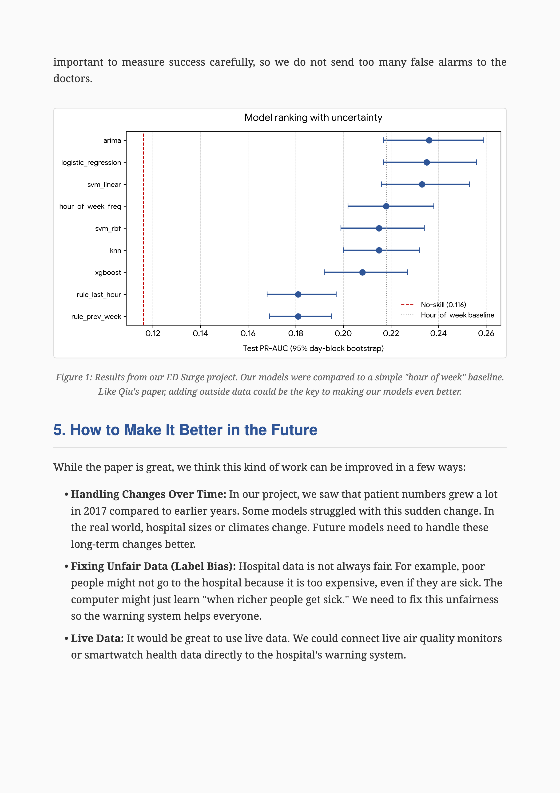

{\rtf1\ansi\ansicpg1252\cocoartf2870
\cocoatextscaling0\cocoaplatform0{\fonttbl\f0\fswiss\fcharset0 Helvetica;}
{\colortbl;\red255\green255\blue255;}
{\*\expandedcolortbl;;}
\paperw11900\paperh16840\margl1440\margr1440\vieww11520\viewh8400\viewkind0
\pard\tx566\tx1133\tx1700\tx2267\tx2834\tx3401\tx3968\tx4535\tx5102\tx5669\tx6236\tx6803\pardirnatural\partightenfactor0

\f0\fs24 \cf0 # Guessing the Future: How Machine Learning Uses Weather to Guess Hospital Visits\
\
**By SJSU_Data245_Group1 members:**\
* Srija Taduri (019166082)\
* Shreya Kaushik (019171490)\
* Xu Wang (018319275)\
* Xuanhua Li (019122974)\
* Anurag Sanadi (014969552)\
\
> **Disclaimer & Citation:** This blog post talks about the paper *"Machine Learning Approaches to Predict Peak Demand Days of Cardiovascular Admissions Considering Environmental Exposure"* by Hang Qiu et al. (2020). All original ideas belong to the authors. You can read the full paper here: [10.1186/s12911-020-1101-8](https://link.springer.com/article/10.1186/s12911-020-1101-8).\
\
## 1. Introduction: The Busy Hospital Problem\
Imagine a hospital emergency room that suddenly gets too full with heart patients. For hospital managers, these very busy days are hard to handle. They cause a lack of beds, tired doctors and nurses, and long waiting times for patients.\
\
But what if we could know about these busy days before they happen?\
\
That is what Hang Qiu and his team tried to do in their 2020 paper. They mixed normal hospital records with weather and air pollution data. By doing this, they built machine learning models (smart computer programs) that can guess when these busy days will happen. This gives hospitals time to prepare.\
\
## 2. How They Did It: Looking Outside the Hospital\
Usually, computers only look at sick people's health records to guess things. But this paper also looked at the weather and air pollution. We know that very cold days or bad smog can cause heart problems.\
\
The researchers wanted to see if they could use today's weather to guess if tomorrow will be a very busy day at the hospital.\
\
* **Mixing Data:** They mixed old hospital records with daily weather data (like heat and rain) and air quality numbers (like PM2.5 and NO2 smog).\
* **The Computer Models:** The team used different machine learning programs to find hidden rules linking the bad weather to hospital visits.\
* **What Matters Most:** The computers did not just guess; they showed the researchers exactly which weather changes were the most important for making a good guess.\
\
## 3. Key Results: A Good Warning System\
The study showed that machine learning can do a very good job of guessing when the hospital will be busy with heart patients.\
\
* **Weather is a Strong Clue:** Air quality and weather are very useful clues. Adding weather data made the computer much smarter than when it only used basic hospital data.\
* **Real-World Use:** This is very useful in real life. If the computer tells the hospital that a busy day is coming in two days because of bad winter smog, the hospital can ask more nurses to come to work and prepare more beds in advance.\
\
## 4. Our Learnings & Our Own Project\
Reading this paper helped us think about our own data science project. We are building an early warning system for an Emergency Department (ED) in Iowa. We also want to guess when the hospital will have a "high demand" hour. Here is how the paper connects to our work:\
\
> **The "Time of Week" Limit**\
> In our project, we found that just guessing based on the "time of the week" (like Friday night) is actually a very strong method. It is hard for complex computer models to beat this simple rule. Patient numbers change based on daily habits. The researchers in this paper faced a similar limit, but they beat it by adding external **weather data**. This taught us that to get better answers, we need to look at outside information, not just time.\
\
Also, our project uses a special scoring rule called **PR-AUC**. We use this because only about 11.5% of hours are truly "high demand" (very busy). When dealing with rare events, it is important to measure success carefully, so we do not send too many false alarms to the doctors.\
\

\
  \
   \
  <em>Figure 1: Results from our ED Surge project. Our models were compared to a simple "hour of week" baseline. Like Qiu's paper, adding outside data could be the key to making our models even better.</em>\

\
\
## 5. How to Make It Better in the Future\
While the paper is great, we think this kind of work can be improved in a few ways:\
\
* **Handling Changes Over Time:** In our project, we saw that patient numbers grew a lot in 2017 compared to earlier years. Some models struggled with this sudden change. In the real world, hospital sizes or climates change. Future models need to handle these long-term changes better.\
* **Fixing Unfair Data (Label Bias):** Hospital data is not always fair. For example, poor people might not go to the hospital because it is too expensive, even if they are sick. The computer might just learn "when richer people get sick." We need to fix this unfairness so the warning system helps everyone.\
* **Live Data:** It would be great to use live data. We could connect live air quality monitors or smartwatch health data directly to the hospital's warning system.\
\
## 6. Conclusion\
The work by Qiu and his team shows how useful data science can be. By mixing weather science and healthcare, they showed a way to save lives through better planning. As climate change makes weather worse, these smart computer tools will be very important for modern hospitals.\
\
***\
\
**References:**\
Qiu, H., et al. (2020). *Machine Learning Approaches to Predict Peak Demand Days of Cardiovascular Admissions Considering Environmental Exposure*. BMC Medical Informatics and Decision Making, 20(1), 83. DOI: 10.1186/s12911-020-1101-8}